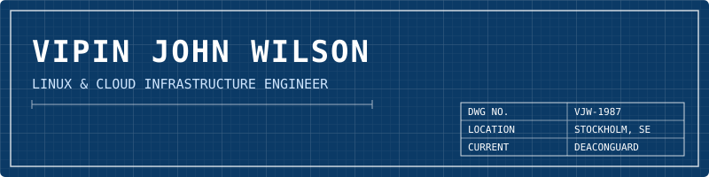
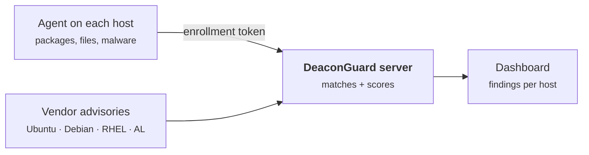

#### What I'm building

**[DeaconGuard](https://github.com/Cloudopsshell/deaconguard)** is a Linux security scanner with a central server and enrollment-token agents. It checks packages against the official Ubuntu, Debian, RHEL and Amazon Linux advisories and covers file integrity, security configuration and malware (ClamAV, plus optional YARA-X rules). [deaconguard.io](https://deaconguard.io)

[deaconguard.io](https://deaconguard.io) · [LinkedIn](https://www.linkedin.com/in/vipinjohnwilson)
